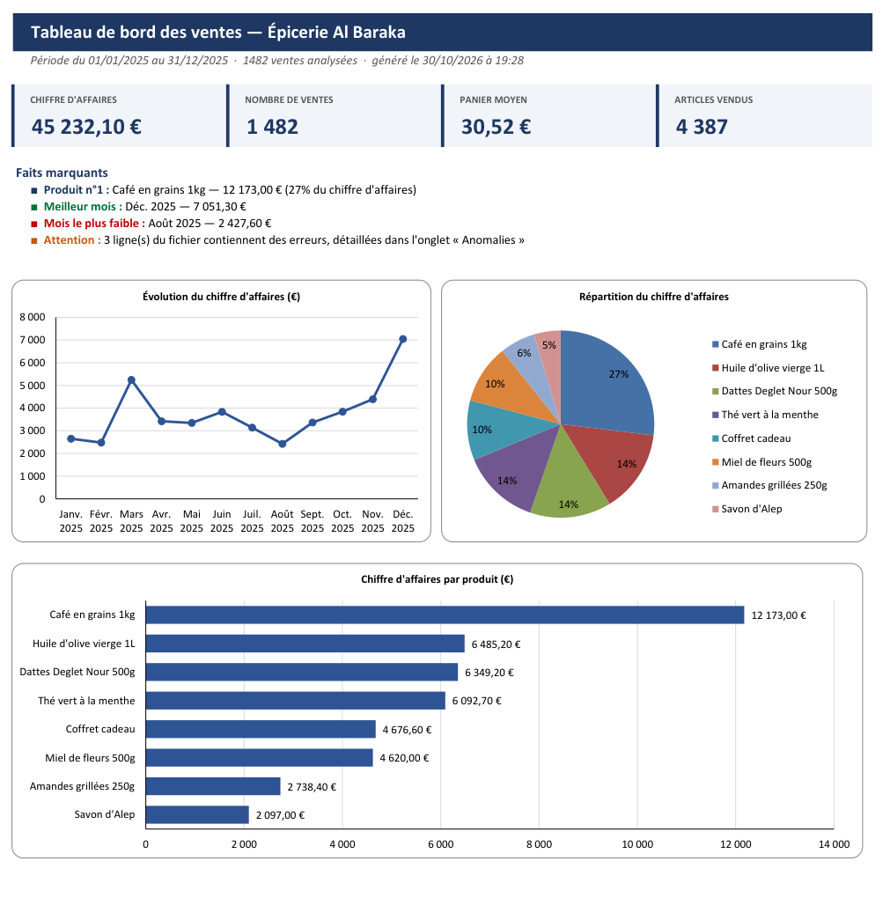

# 📊 Rapport de ventes automatique

**Transformez votre fichier de ventes Excel en tableau de bord professionnel, en une seconde.**

Fini les heures passées chaque mois à faire les bilans à la main : le programme lit vos ventes, fait tous les calculs, repère les erreurs de saisie et génère un rapport Excel prêt à être imprimé ou envoyé.



*Exemple : une année de ventes d'une épicerie fine (1 482 ventes) transformée en rapport en moins d'une seconde.*

---

## ✨ Ce que contient le rapport

| Onglet | Contenu |
|---|---|
| **Tableau de bord** | Chiffres clés (CA, nombre de ventes, panier moyen, articles vendus), faits marquants rédigés automatiquement et 3 graphiques. Tient sur une page A4 à l'impression. |
| **Par produit** | Classement des produits avec quantités, chiffre d'affaires, part du CA et barres de données. |
| **Par mois** | Chiffre d'affaires mois par mois et évolution en % (vert si hausse, rouge si baisse). |
| **Données** | Toutes les ventes nettoyées, avec filtres Excel. |
| **Anomalies** | Les lignes du fichier qui contiennent une erreur, avec le numéro de ligne et le problème. *(seulement s'il y en a)* |

## 🛡️ Conçu pour les vrais fichiers de vrais clients

Les fichiers Excel du monde réel ne sont jamais parfaits. Le programme s'adapte :

- **Colonnes reconnues automatiquement**, quel que soit leur ordre ou leur nom : `Quantité`, `Qté`, `qty`… `Produit`, `Article`, `Désignation`…
- **Titre ou logo au-dessus du tableau** : l'en-tête est trouvé tout seul.
- **Excel (.xlsx) ou CSV**, avec séparateur `;` ou `,` et nombres au format français (`1 234,50 €`).
- **Erreurs de saisie** (date manquante, quantité écrite en lettres, quantité négative…) : la ligne est mise de côté et signalée, au lieu de faire planter le programme ou de fausser les chiffres.
- **Mois sans vente** affichés à 0 au lieu d'être oubliés, et périodes sur plusieurs années gérées correctement.

## 🚀 Utilisation

```bash
# 1. Installer les dépendances
pip install -r requirements.txt

# 2. (facultatif) Créer un fichier d'exemple
python generer_exemple.py

# 3. Générer le rapport
python rapport.py ventes.xlsx --titre "Épicerie Al Baraka"
```

Résultat dans le terminal :

```
Rapport créé : rapport.xlsx
  Période            : 01/01/2025 → 31/12/2025
  Chiffre d'affaires : 45 232,10 €
  Ventes             : 1482  (panier moyen 30,52 €)
  Produit n°1        : Café en grains 1kg
  Meilleur mois      : Déc. 2025
  ⚠ 3 ligne(s) en erreur, détaillées dans l'onglet « Anomalies »
```

### Options

| Option | Rôle | Exemple |
|---|---|---|
| `-o`, `--sortie` | Nom du fichier généré | `-o rapport_2025.xlsx` |
| `-t`, `--titre` | Nom de l'entreprise affiché en en-tête | `--titre "Ma boutique"` |

### Format du fichier d'entrée

Une ligne par vente. Colonnes obligatoires : **date, produit, quantité, prix unitaire**. Colonne facultative : **catégorie**.

| Date | Produit | Quantité | Prix unitaire | Catégorie |
|---|---|---|---|---|
| 12/03/2025 | Dattes Deglet Nour 500g | 3 | 7,80 € | Épicerie |
| 14/03/2025 | Thé vert à la menthe | 5 | 6,90 € | Boissons |

## ✅ Tests

Le projet est couvert par 27 tests automatiques (lecture des nombres et des dates, détection des colonnes, fichiers CSV, anomalies, calculs, génération du rapport) :

```bash
python -m pytest
```

## 🧱 Structure du code

```
rapport.py            Programme principal, en 4 étapes :
                        1. modèle de données   2. lecture du fichier
                        3. analyse             4. création du rapport Excel
generer_exemple.py    Crée un fichier de ventes réaliste (saisonnalité, erreurs volontaires)
tests/                Tests automatiques (pytest)
```

**Technologies :** Python 3.10+, [openpyxl](https://openpyxl.readthedocs.io/), pytest.

---

## 💼 Besoin d'automatiser vos fichiers Excel ?

Ce projet est un exemple de ce que je réalise. Je peux adapter ce type d'outil à **vos** fichiers : rapports clients, suivi de stock, factures, plannings, fusion de fichiers… Contactez-moi.
